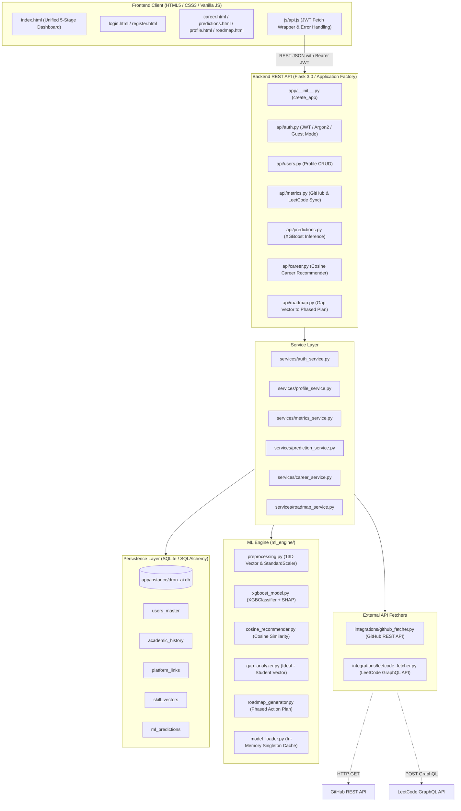

# Dron AI ? Comprehensive Agent Architecture & Context Guide

> **Purpose for AI Agents**: This document is the single source of truth for understanding the entire **Dron AI** codebase. Read this file to understand the system architecture, mathematical formulations, data schemas, API routes, and operational workflows without needing to re-read individual source files repeatedly.

---

## 1. Executive Summary & Core Mission

**Dron AI** is an end-to-end, AI/ML-driven student career intelligence and placement readiness platform designed for engineering undergraduate students.

### The Problem It Solves
- Engineering students often lack clarity on whether their cumulative academic, algorithmic (LeetCode), and software engineering (GitHub) track record makes them competitive for campus placements.
- Generic advice fails because different tech roles require vastly different skill profiles (e.g., SDE vs. Data Analyst vs. DevOps).

### The Core Philosophy
> *"Prediction tells the student where they stand. Personalization tells them what to do next."*

1. **Quantification**: Aggregates disparate student data (academics, GitHub, LeetCode, self-assessment) into a standardized **13-Dimensional Numerical Feature Vector**.
2. **Prediction**: Evaluates placement probability using a trained **XGBoost Classifier** with **SHAP (SHapley Additive exPlanations)** feature attribution.
3. **Recommendation**: Ranks 7 industry career paths using **Cosine Similarity** against predefined target vectors.
4. **Remediation**: Calculates concrete mathematical deficits via **Vector Subtraction** (`Ideal Vector - Student Vector`) and converts gaps into a phased, milestone-based learning roadmap.

---

## 2. High-Level System Architecture



---

## 3. Directory & File Structure

```text
Dron AI/
??? app/                            # Backend Flask Application
?   ??? __init__.py                 # Application Factory (create_app)
?   ??? extensions.py               # db (SQLAlchemy), jwt (JWTManager), limiter, cors
?   ??? api/                        # REST API Blueprints
?   ?   ??? auth.py                 # /api/auth (register, login, me, guest)
?   ?   ??? users.py                # /api/users (profile GET/PUT)
?   ?   ??? metrics.py              # /api/metrics (fetch external data)
?   ?   ??? predictions.py          # /api/predictions (placement inference)
?   ?   ??? career.py               # /api/career (career recommendations)
?   ?   ??? roadmap.py              # /api/roadmap (gap analysis & roadmap)
?   ??? models/                     # Database Models (SQLAlchemy ORM)
?   ?   ??? user.py                 # users_master (Core Student Identity)
?   ?   ??? academic.py             # academic_history (Semester CGPA, backlogs)
?   ?   ??? platform_link.py        # platform_links (External Handles)
?   ?   ??? skill_vector.py         # skill_vectors (Shared PK/FK 10D skills)
?   ?   ??? prediction.py           # ml_predictions (Cached Inference & Audits)
?   ??? services/                   # Business Logic Wrappers
?   ?   ??? auth_service.py         # Password hashing & JWT generation
?   ?   ??? profile_service.py      # Profile retrieval & synchronization
?   ?   ??? metrics_service.py      # Calls external fetchers & updates DB
?   ?   ??? prediction_service.py   # Assembles 13D vector & invokes XGBoost
?   ?   ??? career_service.py       # Assembles skill vector & runs Cosine match
?   ?   ??? roadmap_service.py      # Runs gap subtraction & milestone sequencing
?   ??? scripts/
?   ?   ??? seed_db.py              # Populates 3 demo accounts (Rohan, Priya, Alex)
?   ??? utils/
?       ??? helpers.py              # API response formatting & datetime helpers
?       ??? sanitizer.py            # Input validation, clamping, and XSS sanitization
??? integrations/                   # Live External Data Fetchers
?   ??? github_fetcher.py           # REST fetcher for repos, commits, stars
?   ??? leetcode_fetcher.py         # GraphQL fetcher for solved count, contest rating
??? ml_engine/                      # Machine Learning Core
?   ??? preprocessing.py            # 13D feature extraction, bounding, StandardScaler
?   ??? xgboost_model.py            # XGBClassifier training, inference, and SHAP
?   ??? cosine_recommender.py       # Career matching using Cosine Similarity
?   ??? gap_analyzer.py             # Vector subtraction for skill deficiencies
?   ??? roadmap_generator.py        # Sequenced preparation tasks & milestones
?   ??? model_loader.py             # Singleton memory cache for models & scalers
?   ??? data/
?   ?   ??? career_vectors.json     # 7 target career role benchmark vectors
?   ?   ??? student_career_success_dataset.csv # Training dataset
?   ??? saved_models/
?   ?   ??? xgboost_placement.pkl   # Serialized trained model
?   ?   ??? xgboost_placement.pkl.sha256 # Cryptographic integrity sidecar
?   ?   ??? scaler.pkl              # Fitted StandardScaler object
?   ?   ??? scaler.pkl.sha256       # Cryptographic integrity sidecar
?   ??? scripts/
?   ?   ??? train_model.py          # Script to train, evaluate, and save models
?   ??? tests/
?       ??? test_ml.py              # ML Engine unit and integration tests
??? frontend/                       # Client UI (Modern Dark Mode / Glassmorphism)
?   ??? index.html                  # Unified 5-Stage Interactive Dashboard
?   ??? login.html                  # Authentication Login Screen
?   ??? register.html               # Student Registration Screen
?   ??? profile.html                # Dedicated Profile & Academic Input
?   ??? career.html                 # Dedicated Career Matching Page
?   ??? predictions.html            # Dedicated Placement Prediction Page
?   ??? roadmap.html                # Dedicated Skill Gap & Phased Roadmap Page
?   ??? css/
?   ?   ??? variables.css           # Design tokens, color palette, typography
?   ?   ??? main.css                # Global layouts, typography, navbar, utilities
?   ?   ??? auth.css                # Authentication forms and card styling
?   ?   ??? dashboard.css           # Dashboard metrics, cards, gauges, charts
?   ??? js/
?       ??? api.js                  # Centralized fetch client with JWT injection
?       ??? auth.js                 # Login, register, logout, token persistence
?       ??? app.js                  # Unified index.html controller
?       ??? nav.js                  # Responsive sidebar & navigation behavior
?       ??? profile.js              # Profile form submission & platform sync
?       ??? metrics.js              # Real-time metric displays
?       ??? placement.js            # Placement prediction trigger & rendering
?       ??? career.js               # Career card generation & target selection
?       ??? roadmap.js              # Gap analysis bars & milestone checklist
??? config.py                       # Configuration classes (Development, Testing, Production)
??? conftest.py                     # Root pytest test configuration
??? requirements.txt                # Python package dependencies
??? run.py                          # Flask entrypoint application runner
```

---

## 4. Machine Learning & Mathematics Pipeline

### 4.1 The 13-Dimensional Feature Vector
The ML engine relies on an exact, ordered 13-dimensional feature array:

$$\mathbf{X} = [x_1, x_2, \dots, x_{13}]$$

| Index | Feature Key | Category | Scale / Unit | Description |
|:---:|:---|:---|:---:|:---|
| 0 | `cgpa` | Academic | 0.0 ? 10.0 | Cumulative Grade Point Average |
| 1 | `attendance_pct` | Academic | 0.0 ? 100.0 | Class attendance percentage |
| 2 | `active_backlogs` | Academic | Integer $\ge 0$ | Number of currently unresolved course failures |
| 3 | `dsa_score` | Technical | 0.0 ? 100.0 | Data Structures & Algorithms proficiency score |
| 4 | `python_prof` | Technical | 0.0 ? 100.0 | Python programming proficiency score |
| 5 | `cpp_prof` | Technical | 0.0 ? 100.0 | C++ programming proficiency score |
| 6 | `aiml_knowledge` | Technical | 0.0 ? 100.0 | Machine Learning & AI conceptual knowledge |
| 7 | `total_commits` | Platform | Integer $\ge 0$ | Cumulative GitHub commits in past 12 months |
| 8 | `problems_solved` | Platform | Integer $\ge 0$ | Total solved coding problems (LeetCode) |
| 9 | `contest_rating` | Platform | Float $\ge 0.0$ | LeetCode contest rating (e.g. 1500?2200) |
| 10 | `project_count` | Experience | Integer $\ge 0$ | Number of verified technical projects |
| 11 | `communication_score` | Soft Skill | 0.0 ? 100.0 | Interview & verbal communication rating |
| 12 | `internship_exp` | Experience | Integer $\ge 0$ | Completed technical internship duration (months) |

### 4.2 Data Normalization & Integrity
1. **Bounds Clamping**: Features are clamped within physical boundaries via `FEATURE_BOUNDS` in `ml_engine/preprocessing.py`.
2. **StandardScaler**: Scaled using $\mu$ and $\sigma$ fitted during model training:
   $$z_i = rac{x_i - \mu_i}{\sigma_i}$$
3. **Cryptographic Checksum Verification**: Serialized models (`xgboost_placement.pkl`, `scaler.pkl`) have accompanying `.sha256` sidecars. `model_loader.py` validates hashes prior to unpickling to prevent code execution vulnerabilities and detect corruption.

### 4.3 XGBoost Placement Inference & Readiness Tiers
- **Model**: `XGBClassifier` trained on binary placement outcomes (Placed $= 1$, Not Placed $= 0$).
- **Inference Time Target**: $< 2	ext{ms}$ per request (SLA $< 5	ext{ms}$).
- **Readiness Tier Classification**:
  - $P(	ext{Placement}) \ge 0.80$: **Highly Prepared** (Tier-1 ready track)
  - $0.60 \le P(	ext{Placement}) < 0.80$: **Prepared** (Tier-2 ready track)
  - $0.40 \le P(	ext{Placement}) < 0.60$: **Needs Improvement** (Deficiency remediation required)
  - $P(	ext{Placement}) < 0.40$: **High Risk / Action Required** (Critical intervention needed)

### 4.4 Explainable AI (XAI) via SHAP
- Global feature importance is precomputed from tree split gains.
- Individual predictions calculate local **SHAP values** via `shap.TreeExplainer(model)` to reveal which specific dimensions increased or decreased the student's probability.

### 4.5 Cosine Similarity Career Recommendation
Compares the student's 10 technical & platform metrics against 7 predefined career benchmark vectors:

$$	ext{Similarity}(S, C) = rac{\mathbf{S} \cdot \mathbf{C}}{\|\mathbf{S}\|_2 \|\mathbf{C}\|_2} = rac{\sum_{i=1}^{10} S_i C_i}{\sqrt{\sum_{i=1}^{10} S_i^2} \sqrt{\sum_{i=1}^{10} C_i^2}}$$

Available Career Profiles:
1. **Software Engineer**: Heavy emphasis on `dsa_score`, `total_commits`, `problems_solved`.
2. **Data Analyst**: Heavy emphasis on `python_prof`, `communication_score`, `aiml_knowledge`.
3. **ML Engineer**: Heavy emphasis on `aiml_knowledge`, `python_prof`, `dsa_score`.
4. **Web Developer**: Heavy emphasis on `total_commits`, `project_count`, `python_prof`.
5. **DevOps Engineer**: Balanced systems, automation, and project execution.
6. **Cloud Architect**: Emphasis on infrastructure, projects, and communication.
7. **Cybersecurity Analyst**: Strong emphasis on systems, C++, and analytical problem solving.

### 4.6 Skill-Gap Subtraction & Roadmap Sequencing
1. **Deficit Vector**:
   $$\Delta_i = \max(0, 	ext{IdealRole}_i - 	ext{Student}_i)$$
2. **Gap Ranking**: Sorted in descending order of delta severity.
3. **Phased Roadmap**: Converts the top deficits into a 3-phase chronological action plan with concrete milestones, recommended problem counts, and estimated durations (e.g. 2 to 6 weeks per phase).

---

## 5. Database Schema & SQLAlchemy Relationships

The system uses SQLite (or MySQL) configured in `config.py` with 5 relational tables:

```text
users_master (1) ????????? (N) academic_history   [Cascade Delete]
                     ????? (1) platform_links     [Cascade Delete, Unique FK]
                     ????? (1) skill_vectors      [Cascade Delete, Shared PK/FK]
                     ????? (N) ml_predictions     [Cascade Delete, Indexed FK]
```

1. **`users_master`**: Core identity (student ID, full name, email, password hash, cohort year, branch).
2. **`academic_history`**: Semester progression (student ID, semester, CGPA, attendance, backlogs). Unique constraint on `(student_id, semester)`.
3. **`platform_links`**: External usernames (GitHub, LeetCode, LinkedIn, `last_synced` timestamp).
4. **`skill_vectors`**: 10 quantitative skill metrics. **Shared PK/FK Pattern**: `student_id` is both the Primary Key and Foreign Key to `users_master`.
5. **`ml_predictions`**: Audit log of historical inferences with cached probabilities, tiers, SHAP importance JSON, and roadmap JSON.

---

## 6. REST API Endpoints Quick Reference

| Method | Endpoint | Auth | Purpose |
|:---:|:---|:---:|:---|
| `POST` | `/api/auth/register` | Public | Create new student account |
| `POST` | `/api/auth/login` | Public | Authenticate student, return Bearer JWT |
| `POST` | `/api/auth/guest` | Public | Issue temporary guest demo token |
| `GET` | `/api/auth/me` | JWT | Get authenticated student identity |
| `GET` | `/api/users/profile` | JWT | Fetch student profile, academics, links & skills |
| `PUT` | `/api/users/profile` | JWT | Update profile details and self-assessed skills |
| `POST` | `/api/metrics/fetch` | JWT | Trigger live external GitHub & LeetCode sync |
| `POST` | `/api/predictions/placement` | JWT | Run XGBoost placement inference & assign tier |
| `POST` | `/api/career/recommend` | JWT | Calculate cosine match scores for all 7 roles |
| `POST` | `/api/roadmap/generate` | JWT | Run gap analysis against target role & build roadmap |

---

## 7. Developer & Agent Cheat Sheet

### Running the Application Locally
```bash
# 1. Activate virtual environment
.venv\Scripts\activate   # Windows

# 2. Run backend API server (runs at http://localhost:5000)
python run.py

# 3. Open frontend
# Open frontend/index.html in any modern browser or run live-server
```

### Running Test Suite
```bash
# Run all unit and integration tests (74 tests)
pytest

# Run only ML engine tests
pytest ml_engine/tests/test_ml.py

# Run API tests
pytest app/tests/test_api.py
```

### Retraining ML Models
```bash
# Trains XGBoost on dataset, evaluates metrics, and generates .sha256 sidecars
python ml_engine/scripts/train_model.py
```

### Database Initialization & Seeding
```bash
# Initialize DB tables and seed demo accounts (Rohan, Priya, Alex)
python app/scripts/seed_db.py

# Reset database from scratch
python app/scripts/seed_db.py --reset
```

### Pre-loaded Demo Accounts
- **Account 1**: `rohan@dron.ai` / `password123` (High Performer: 8.92 CGPA, 180 commits, 340 LeetCode)
- **Account 2**: `priya@dron.ai` / `password123` (Moderate Performer: 7.65 CGPA, 45 commits, 110 LeetCode)
- **Account 3**: `alex@dron.ai` / `password123` (Needs Remediation: 5.80 CGPA, 12 commits, 25 LeetCode)

---

## 8. Critical Agent Rules & Invariants

1. **Feature Vector Ordering**: Never alter the 13-element order in `FEATURE_NAMES` (`preprocessing.py`). Any change alters model input and silently corrupts predictions.
2. **Checksum Enforcement**: Serialized models must always have a `.sha256` sidecar file alongside them (`xgboost_placement.pkl.sha256`). If omitted, `model_loader.py` raises `ChecksumNotFoundError`.
3. **Database Cascades**: Deleting a student cascades deletions across all 4 child tables via `passive_deletes=True` + `ondelete="CASCADE"`.
4. **Session Rollback**: Any database mutation must be wrapped in `try ... except ... db.session.rollback()` to prevent deadlocking the connection pool.
5. **No Blind Code Modifications**: Backend services (`app/services/`), blueprints (`app/api/`), and frontend styles should only be touched when their specific feature contracts require changes.
